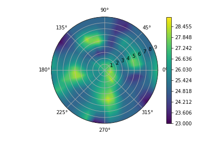

<p align="center">
  
</p>

<h1 align="center">MAIA microperimetry rings</h1>

<p align="center">
  Eccentricity-ring averages of retinal sensitivity, with scatter and radar plots, from a MAIA microperimetry measurement.
</p>

<p align="center">
  <a href="https://github.com/brainlife/abcd-spec"></a>
  <a href="https://doi.org/10.25663/brainlife.app.493"></a>
  <a href="LICENSE"></a>
</p>

## At a glance

<!-- brainlife-app:begin (generated from the App manifest; edit the manifest, not this block) -->

> **Computes eccentricity-ring averages of MAIA microperimetry retinal sensitivity measurements with the OCT_scripts groupMAIA Python tools, with scatter and radar plots.**

Converts the MAIA microperimetry table to polar coordinates, averages sensitivity within degree-based rings (groupMAIA.ringMeanDev) and saves ringMeanTable.csv plus scatter and radar plots, which are also shown on brainlife. The code clones github.com/DanNBullock/OCT_scripts at run time, so it needs network access. The README is an unfilled template.

| | |
|---|---|
| **Inputs** | `neuro/microperimetry` |
| **Outputs** | `raw` |
| **Container** | `brainlife/dipy:1.4.0` |
| **Resources** | 1 CPUs · 8 GB memory |
| **Run it** | [doi.org/10.25663/brainlife.app.493](https://doi.org/10.25663/brainlife.app.493) |

#### Inputs

| Input | Datatype | Required | Description |
|---|---|---|---|
| `microperimetry` | `neuro/microperimetry` | yes | MAIA microperimetry measurement export for one eye/session. |

#### Outputs

| Output | Datatype | Description |
|---|---|---|
| `output` | `raw` | ringMeanTable.csv with ring-wise mean sensitivity, plus scatterPlot.png and radarPlot.png. |

<!-- brainlife-app:end -->

## Running the App

### On brainlife.io

Open the App at [doi.org/10.25663/brainlife.app.493](https://doi.org/10.25663/brainlife.app.493), choose a `neuro/microperimetry` dataset (the MAIA microperimetry export for one eye and session) and press **Execute**. The App writes a `raw` dataset tagged `microperimetryRings` to your project and shows the scatter and radar plots on the results page.

### How it works

The App uses the `groupMAIA` module of [OCT_scripts](https://github.com/DanNBullock/OCT_scripts):

1. The MAIA measurement table is converted to polar coordinates (`loadAndConvertMAIA_polar`).
2. Sensitivity is averaged within degree-based eccentricity rings (`ringMeanDev`).
3. A scatter plot of the measurement points and a radar plot of the ring averages are drawn.

OCT_scripts is a git submodule of this repository. Because brainlife.io does not clone submodules, `main` clones it from GitHub at run time, so the App needs network access.

### Locally

You need [Singularity/Apptainer](https://apptainer.org/), `git` and network access. The App runs in the `brainlife/dipy:1.4.0` container.

1. Clone this repository.
2. Create `config.json` with the path to your MAIA export (see `config.json.example`):

   ```json
   {
       "microperimetry": "microperimetry.tsv"
   }
   ```

3. Run the App:

   ```bash
   ./main
   ```

## Outputs

```text
output/
├── ringMeanTable.csv   mean sensitivity per eccentricity ring
├── scatterPlot.png     measurement points coloured by sensitivity
└── radarPlot.png       ring-wise sensitivity
```

## Citing

> [!TIP]
> If you use this App in your work, please cite the App, the software it builds on and brainlife.io (below). GitHub's **Cite this repository** button gives the App citation in APA and BibTeX.

- Avesani P, McPherson B, Hayashi S, et al. The open diffusion data derivatives, brain data upcycling via integrated publishing of derivatives and reproducible open cloud services. *Scientific Data* 6:69 (2019). [doi:10.1038/s41597-019-0073-y](https://doi.org/10.1038/s41597-019-0073-y)
-  MAIA microperimetry analysis. brainlife.io App. [doi:10.25663/brainlife.app.493](https://doi.org/10.25663/brainlife.app.493)
- Garyfallidis et al. Dipy, a library for the analysis of diffusion MRI data. *Frontiers in Neuroinformatics* 8 (2014). [doi:10.3389/fninf.2014.00008](https://doi.org/10.3389/fninf.2014.00008)
- Hayashi S, Caron BA, Heinsfeld AS, et al. brainlife.io: a decentralized and open-source cloud platform to support neuroscience research. *Nature Methods* 21:809–813 (2024). [doi:10.1038/s41592-024-02237-2](https://doi.org/10.1038/s41592-024-02237-2)

## Authors

- [Dan Bullock](https://github.com/DanNBullock)

**Contributors:** Soichi Hayashi

## Funding

[](https://wellcome.org/)
[](https://reporter.nih.gov/project-details/11261037)
[](https://reporter.nih.gov/project-details/11411328)
[](https://reporter.nih.gov/project-details/10262925)
[](https://reporter.nih.gov/project-details/10428625)
[](https://reporter.nih.gov/project-details/10460628)
[](https://reporter.nih.gov/project-details/11140284)
[](https://www.nsf.gov/awardsearch/showAward?AWD_ID=1734853)
[](https://www.nsf.gov/awardsearch/showAward?AWD_ID=2203524)
[](https://www.nsf.gov/awardsearch/showAward?AWD_ID=1636893)
[](https://www.nsf.gov/awardsearch/showAward?AWD_ID=2148729)
[](https://www.nsf.gov/awardsearch/showAward?AWD_ID=1912270)
[](https://www.nsf.gov/awardsearch/showAward?AWD_ID=2148700)
[](https://www.nsf.gov/awardsearch/showAward?AWD_ID=1916518)

<sub>brainlife.io is publicly funded, and acknowledging that support helps keep it running. This App was developed with support from Wellcome, the U.S. National Institutes of Health (including the BRAIN Initiative BRAIN CONNECTS program: The Axonal Projectome EXchange, U24NS140384, and the Center for Mesoscale Connectomics, UM1NS132207) and the U.S. National Science Foundation.</sub>

## License

[MIT](LICENSE).
